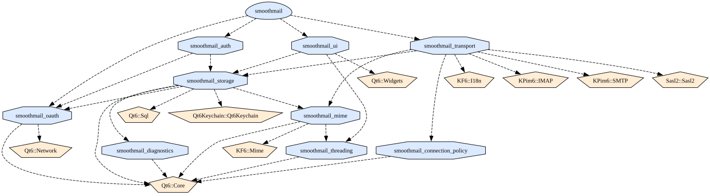

# 構成と依存関係

## モジュール

アプリはC++20／Qt Widgetsで構成します。`src/main.cpp`が起動入口です。

| ディレクトリ | 役割・主な依存 |
|---|---|
| `src/app` | `ApplicationController`がUI操作と非同期メール処理を接続。UI・保存・通信・認証を統括 |
| `src/core` | アカウント・メール等の値モデル、診断、スレッド構築。Qt Core |
| `src/storage` | SQLiteによるアカウント・メールキャッシュ、設定、添付保存。Qt SQL、QtKeychain、MIME・OAuth |
| `src/mail` | IMAP／SMTP、MIME解析・生成、接続方針、OAuth・認証仲介。KIMAP、KSMTP、KMime、Qt Network、保存層 |
| `src/ui` | メイン画面、本文・一覧・各ダイアログ。Qt Widgets、保存層、スレッド構築 |

CMakeでは診断・接続方針・OAuth・保存・認証・スレッド・通信・MIME・UIを`smoothmail_*`静的ライブラリに分け、実行対象`smoothmail`へリンクします。外部LGPLライブラリは動的リンクです。

通信・MIME解析・DB処理はGUIスレッドから分離し、DB接続は専用ワーカー内で管理します。認証情報はQtKeychainへ保存し、平文保存へ自動で切り替えません。メール本文は安全なプレインテキスト表示とし、HTML表示エンジンは依存に含みません。

## 外部ライブラリ・ツール

| 分類 | 使用対象 |
|---|---|
| GUI・基盤 | Qt Core／Gui／Widgets／Network／Sql。推移依存にXml／Svg。QSQLITE、Windows TLS・platformプラグイン |
| メール | KIMAP、KSMTP、KMime、KCodecs、Cyrus SASLとPLAIN／LOGIN／XOAUTH2機構 |
| KDE基盤 | KIOCore、KI18n、KService、KConfigCore、KCoreAddons、KCrash |
| 秘密情報 | QtKeychain |
| GNUランタイム | libiconv、gettext-libintl |
| ビルド | Git、CMake、MSVC 2022 x64／Windows SDK、既存Qt SDK。ECM、Ninja、vcpkg、gettextホストツール、winflexbisonは依存構築で準備 |
| バッチ・依存内処理 | Python 3（本体のコンパイル処理には使用しない） |
| テスト | Qt Test、CTest、合成IMAP／SMTP／OAuthサーバ |
| 依存図 | Doxygen、Graphviz（`dot`）。図の再生成時のみ必要 |

固定版・取得元は[`dependencies.json`](../../cmake/dependencies.json)、[`native-dependencies.json`](../../cmake/native-dependencies.json)、[`source-archives.json`](../../cmake/source-archives.json)を参照してください。Qtは手動導入したSDKを使用し、別のQtを自動取得しません。パッチは[`patches/`](../../patches/)、ライセンス方針は[仕様](../../spec/license-handling.md)で管理します。

## 自動生成した依存図

矢印は利用側から依存先を表します。青は当プロジェクト、橙は外部ライブラリです。テスト・実認証probe・配布補助ターゲットは含めません。

### CMakeターゲット



### ソースファイル

[全体図（SVG）](architecture/files.svg)。Doxygenが解決したプロジェクト内のincludeと、外部ヘッダへの直接includeを示します。外部ライブラリ内部の全ソースの走査や実行時の呼出し関係は含みません。

### ソースディレクトリ


当プロジェクトの`src/`だけを集約し、同一ディレクトリ内の依存と外部ライブラリを除きます。

### 再生成

[構築済み](build.md)のアプリビルドディレクトリを指定し、Doxygen・GraphvizをPATHへ登録します。WindowsではMSVC開発者環境で実行します。

```text
python tools/generate_architecture.py --build build/windows/Release --output build/architecture
```

PythonがCMakeのGraphviz出力とDoxygen XMLを収集・分類し、GraphvizでSVG化します。ビルドやCTestからは実行しません。既存の出力先は上書きしません。図を確認後、生成された6ファイル（DOT・SVG各3つ）を`docs/dev/architecture/`へ反映します。実行ファイルの絶対パスは`--doxygen`／`--dot`でも指定できます。
