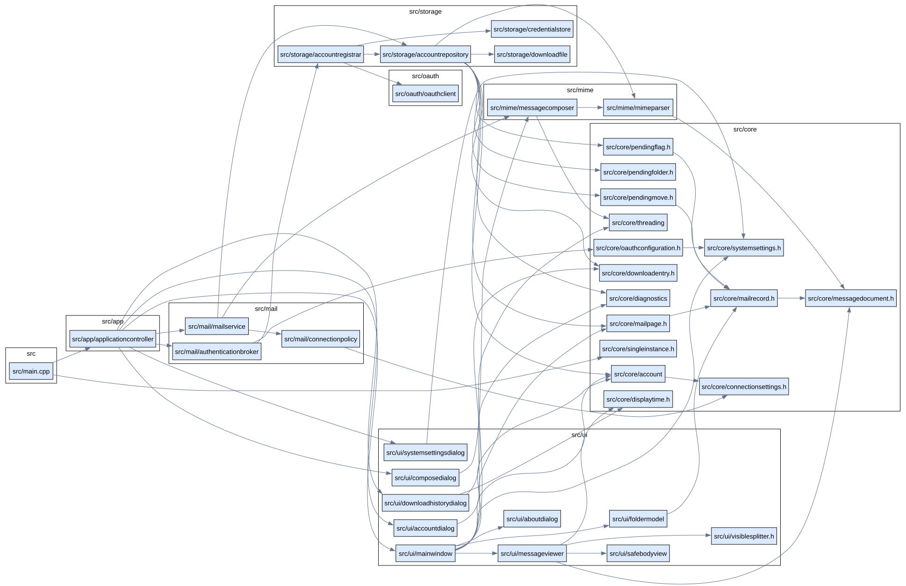

# 構成と依存関係

## モジュール

アプリはC++20／Qt Widgetsで構成します。`src/main.cpp`が起動入口です。

| ディレクトリ | 役割・主な依存 |
|---|---|
| `src/app` | `ApplicationController`がUI操作と非同期メール処理を接続。UI・保存・通信・認証を統括 |
| `src/core` | アカウント・メール等の値モデル、診断、スレッド構築。Qt Core |
| `src/storage` | SQLiteによるアカウント・メールキャッシュ、設定、添付保存。Qt SQL、QtKeychain、MIME・OAuth |
| `src/mail` | IMAP／SMTP、MIME解析・生成、接続方針、OAuth・認証仲介。KIMAP、KSMTP、KMime、Qt Network、保存層 |
| `src/ui` | メイン画面、本文・一覧・各ダイアログ。Qt Widgets、保存層、スレッド構築 |

CMakeでは診断・接続方針・OAuth・保存・認証・スレッド・通信・MIME・UIを`smoothmail_*`静的ライブラリに分け、実行対象`smoothmail`へリンクします。外部LGPLライブラリは動的リンクです。

通信・MIME解析・DB処理はGUIスレッドから分離し、DB接続は専用ワーカー内で管理します。認証情報はQtKeychainへ保存し、平文保存へ自動で切り替えません。メール本文は安全なプレインテキスト表示とし、HTML表示エンジンは依存に含みません。

## 外部ライブラリ・ツール

| 分類 | 使用対象 |
|---|---|
| GUI・基盤 | Qt Core／Gui／Widgets／Network／Sql。推移依存にXml／Svg。QSQLITE、Windows TLS・platformプラグイン |
| メール | KIMAP、KSMTP、KMime、KCodecs、Cyrus SASLとPLAIN／LOGIN／XOAUTH2機構 |
| KDE基盤 | KIOCore、KI18n、KService、KConfigCore、KCoreAddons、KCrash |
| 秘密情報 | QtKeychain |
| GNUランタイム | libiconv、gettext-libintl |
| ビルド | Git、CMake、MSVC 2022 x64／Windows SDK、既存Qt SDK。ECM、Ninja、vcpkg、gettextホストツール、winflexbisonは依存構築で準備 |
| バッチ・依存内処理 | Python 3（本体のコンパイル処理には使用しない） |
| テスト | Qt Test、CTest、合成IMAP／SMTP／OAuthサーバ |
| 依存図・表 | Doxygen、Graphviz（`dot`・`tred`・`unflatten`）、Tree-sitterとC++文法。資料の再生成時のみ必要 |

固定版・取得元は[`dependencies.json`](../../cmake/dependencies.json)、[`native-dependencies.json`](../../cmake/native-dependencies.json)、[`source-archives.json`](../../cmake/source-archives.json)を参照してください。Qtは手動導入したSDKを使用し、別のQtを自動取得しません。パッチは[`patches/`](../../patches/)、ライセンス方針は[仕様](../../spec/license-handling.md)で管理します。

## 自動生成した依存図

矢印は利用側から依存先を表します。ターゲット図では青が当プロジェクト、橙が外部ライブラリです。他の図は当プロジェクトだけを対象とします。テスト・実認証probe・配布補助ターゲットは含めません。

### CMakeターゲット


### ソースファイル



Doxygenが解決した`src/`内のincludeを示します。同じディレクトリの同名`.h`／`.cpp`を一つの頂点へ統合し、ディレクトリごとにグループ化します。外部ヘッダは除き、統合後の自己依存を除去します。

### ソースディレクトリ


当プロジェクトの`src/`だけを集約し、同一ディレクトリ内の依存と外部ライブラリを除きます。

### クラス


Doxygenの参照解決とTree-sitterのC++構文解析を併用し、定義元ディレクトリごとにグループ化します。`struct`も対象です。戻り値・引数・内部の型利用・関数呼出しを追い、グローバル関数の呼出し連鎖による依存もクラス間の辺に集約します。グローバル関数自体や外部ライブラリのクラスは頂点にしません。

頂点ラベルは名前空間を省略しますが、解析上は完全修飾名で区別します。同じ短い名前でも別クラスを統合しません。ファイル図・クラス図では、依存の種類を区別せず`tred`で推移的な辺を縮約し、`unflatten -l 3 -f`を適用します。循環依存がある場合、縮約結果は唯一ではありません。

これは静的な構造資料であり、実行時の全呼出しを保証するものではありません。オーバーロードは候補を保守的に集約し、仮想呼出し・関数ポインタ・マクロ展開・テンプレートの全実体化は完全には解決しません。

### 再生成

[構築済み](build.md)のアプリビルドディレクトリを指定し、Doxygen・GraphvizをPATHへ登録します。WindowsではMSVC開発者環境で実行します。Tree-sitterの文書生成専用依存は次のように導入します（本体ビルドには不要）。

```text
python -m pip install -r tools/architecture-requirements.txt
```

```text
python tools/generate_architecture.py --build build/windows/Release --output build/architecture --document docs/dev/architecture.md
```

PythonがCMakeのGraphviz出力・file API、Doxygen XML、Tree-sitterの構文木を収集して図・表を生成します。ビルドやCTestから資料生成は実行しません。既存の出力先は上書きしません。図を確認後、生成された8ファイル（DOT・SVG各4つ）を`docs/dev/architecture/`へ反映します。`tables.md`は表の生成断片です。`--document`を指定すると当文書の生成マーカー内だけを更新します。手書き部分は保持します。

実行ファイルの絶対パスは`--doxygen`／`--dot`／`--tred`／`--unflatten`でも指定できます。`tred`と`unflatten`の省略時は`dot`と同じディレクトリから探します。CMakeの既存Graphviz設定がある場合は上書きせず停止します。ソース・ターゲットの追加変更後は図と表を一緒に再生成してください。

## ターゲット別ソース一覧（自動生成）

CMake file APIの当プロジェクトのターゲットを対象に、生成ソース・テスト・外部ソースを除きます。各ソースの定義クラス・定義グローバル関数・直接includeヘッダはTree-sitterから抽出します。include欄には外部ヘッダも掲載します。各項目を1行ずつ記載し、ファイル名が空欄の行は直前のファイルの続きです。

<!-- BEGIN GENERATED SOURCE TABLES -->

### `smoothmail`

| ソースファイル | 定義クラス | 定義グローバル関数 | includeヘッダ |
|---|---|---|---|
| src/app/applicationcontroller.cpp | smoothmail::OperationCommand |  | &quot;applicationcontroller.h&quot; |
|  |  |  | &quot;mail/authenticationbroker.h&quot; |
|  |  |  | &quot;mail/mailservice.h&quot; |
|  |  |  | &quot;storage/accountregistrar.h&quot; |
|  |  |  | &quot;ui/accountdialog.h&quot; |
|  |  |  | &quot;ui/composedialog.h&quot; |
|  |  |  | &quot;ui/downloadhistorydialog.h&quot; |
|  |  |  | &quot;ui/mainwindow.h&quot; |
|  |  |  | &quot;ui/systemsettingsdialog.h&quot; |
|  |  |  | &lt;QApplication&gt; |
|  |  |  | &lt;QDesktopServices&gt; |
|  |  |  | &lt;QLineEdit&gt; |
|  |  |  | &lt;QMessageBox&gt; |
|  |  |  | &lt;QPlainTextEdit&gt; |
|  |  |  | &lt;QProgressDialog&gt; |
|  |  |  | &lt;QSettings&gt; |
|  |  |  | &lt;QStandardPaths&gt; |
|  |  |  | &lt;QStatusBar&gt; |
|  |  |  | &lt;QTextDocument&gt; |
|  |  |  | &lt;QUndoCommand&gt; |
|  |  |  | &lt;QUndoStack&gt; |
|  |  |  | &lt;QUuid&gt; |
|  |  |  | &lt;utility&gt; |
| src/app/applicationcontroller.h | smoothmail::ApplicationController |  | &quot;core/account.h&quot; |
|  | smoothmail::ApplicationController::Active |  | &quot;core/systemsettings.h&quot; |
|  | smoothmail::ApplicationController::Request |  | &lt;QHash&gt; |
|  |  |  | &lt;QObject&gt; |
|  |  |  | &lt;QPointer&gt; |
|  |  |  | &lt;QQueue&gt; |
|  |  |  | &lt;QSet&gt; |
| src/main.cpp |  | main(int argc, char *argv[]) | &quot;app/applicationcontroller.h&quot; |
|  |  |  | &quot;core/diagnostics.h&quot; |
|  |  |  | &quot;ui/mainwindow.h&quot; |
|  |  |  | &lt;QApplication&gt; |
|  |  |  | &lt;QMessageBox&gt; |
|  |  |  | &lt;QStandardPaths&gt; |

### `smoothmail_auth`

| ソースファイル | 定義クラス | 定義グローバル関数 | includeヘッダ |
|---|---|---|---|
| src/mail/authenticationbroker.cpp |  |  | &quot;authenticationbroker.h&quot; |
|  |  |  | &quot;storage/accountregistrar.h&quot; |
|  |  |  | &quot;storage/credentialstore.h&quot; |
|  |  |  | &lt;QPointer&gt; |
| src/mail/authenticationbroker.h | smoothmail::AuthenticationBroker |  | &quot;core/account.h&quot; |
|  |  |  | &quot;oauthclient.h&quot; |
|  |  |  | &lt;QHash&gt; |
|  |  |  | &lt;QPointer&gt; |
|  |  |  | &lt;functional&gt; |

### `smoothmail_connection_policy`

| ソースファイル | 定義クラス | 定義グローバル関数 | includeヘッダ |
|---|---|---|---|
| src/mail/connectionpolicy.cpp |  | smoothmail::authenticationDecision(EncryptionMode encryption,
                                                 AuthenticationMode authentication,
                                                 const TransportSecurity &amp;transport,
                                                 const QStringList &amp;advertisedMechanisms) | &quot;connectionpolicy.h&quot; |
| src/mail/connectionpolicy.h | smoothmail::AuthenticationDecision |  | &lt;QString&gt; |
|  | smoothmail::TransportSecurity |  | &lt;QStringList&gt; |

### `smoothmail_diagnostics`

| ソースファイル | 定義クラス | 定義グローバル関数 | includeヘッダ |
|---|---|---|---|
| src/core/diagnostics.cpp |  | smoothmail::diagnostics::aborted(int) | &quot;diagnostics.h&quot; |
|  |  | smoothmail::diagnostics::appendRecord(const QByteArray &amp;entry) | &lt;QCoreApplication&gt; |
|  |  | smoothmail::diagnostics::containsFixed(const Character *text, const Character *needle) | &lt;QCryptographicHash&gt; |
|  |  | smoothmail::diagnostics::crtReport(int type, char *message, int *) | &lt;QDateTime&gt; |
|  |  | smoothmail::diagnostics::crtReportWide(int type, wchar_t *message, int *) | &lt;QDir&gt; |
|  |  | smoothmail::diagnostics::currentOperation() | &lt;QFile&gt; |
|  |  | smoothmail::diagnostics::event(const char *stage, qint64 count) | &lt;QLoggingCategory&gt; |
|  |  | smoothmail::diagnostics::fatal(EXCEPTION_POINTERS *exception) | &lt;QMutex&gt; |
|  |  | smoothmail::diagnostics::finish() | &lt;QScopedValueRollback&gt; |
|  |  | smoothmail::diagnostics::folderValidationFailure(FolderWriteSource source, const FolderValidationFailure &amp;failure) | &lt;QUuid&gt; |
|  |  | smoothmail::diagnostics::nextOperation() | &lt;atomic&gt; |
|  |  | smoothmail::diagnostics::qtMessage(QtMsgType type, const QMessageLogContext &amp;context, const QString &amp;message) | &lt;crtdbg.h&gt; |
|  |  | smoothmail::diagnostics::qtStage(QtMsgType type, const char *category) | &lt;csignal&gt; |
|  |  | smoothmail::diagnostics::recordStack(const char *reason) | &lt;cstdlib&gt; |
|  |  | smoothmail::diagnostics::start(const QString &amp;directory) | &lt;exception&gt; |
|  |  | smoothmail::diagnostics::terminated() | &lt;windows.h&gt; |
|  |  | smoothmail::diagnostics::writeFixed(const char *text) |  |
|  |  | smoothmail::diagnostics::writeNumber(const char *label, quintptr value) |  |
| src/core/diagnostics.h | smoothmail::diagnostics::FolderValidationFailure |  | &lt;QString&gt; |
|  | smoothmail::diagnostics::OperationScope |  |  |

### `smoothmail_mime`

| ソースファイル | 定義クラス | 定義グローバル関数 | includeヘッダ |
|---|---|---|---|
| src/mail/messagecomposer.cpp |  | smoothmail::addresses(const QString &amp;field, QStringList &amp;result) | &quot;messagecomposer.h&quot; |
|  |  | smoothmail::composeMessage(const ComposeData &amp;draft, bool saveAsDraft) | &quot;mimeparser.h&quot; |
|  |  | smoothmail::replyDraft(const QString &amp;from, const MessageDocument &amp;parent) | &lt;KMime/Headers&gt; |
|  |  |  | &lt;KMime/Message&gt; |
|  |  |  | &lt;QDateTime&gt; |
| src/mail/messagecomposer.h | smoothmail::ComposeData |  | &quot;core/messagedocument.h&quot; |
|  | smoothmail::ComposedMessage |  | &quot;core/threading.h&quot; |
|  |  |  | &lt;QMetaType&gt; |
| src/mail/mimeparser.cpp |  | smoothmail::collectParts(const KMime::Content &amp;content, const QString &amp;id, int depth,
                   int &amp;partCount, MessageDocument &amp;document) | &quot;mimeparser.h&quot; |
|  |  |  | &lt;KMime/Content&gt; |
|  |  |  | &lt;KMime/Headers&gt; |
|  |  |  | &lt;KMime/Message&gt; |
|  |  |  | &lt;KMime/Util&gt; |
|  |  |  | &lt;utility&gt; |
| src/mail/mimeparser.h | smoothmail::AttachmentResult |  | &quot;core/messagedocument.h&quot; |
|  | smoothmail::MessageParseResult |  |  |
|  | smoothmail::MimeParser |  |  |

### `smoothmail_oauth`

| ソースファイル | 定義クラス | 定義グローバル関数 | includeヘッダ |
|---|---|---|---|
| src/mail/oauthclient.cpp |  | smoothmail::form(const QList&lt;QPair&lt;QString, QString&gt;&gt; &amp;parameters) | &quot;oauthclient.h&quot; |
|  |  | smoothmail::pkceChallenge(const QByteArray &amp;verifier) | &lt;QCryptographicHash&gt; |
|  |  | smoothmail::randomUrlValue() | &lt;QHostAddress&gt; |
|  |  | smoothmail::refreshGrant(const QString &amp;token) | &lt;QJsonDocument&gt; |
|  |  | smoothmail::refreshTokenFromGrant(const QString &amp;grant) | &lt;QJsonObject&gt; |
|  |  | smoothmail::safeOpaque(const QString &amp;value) | &lt;QNetworkAccessManager&gt; |
|  |  | smoothmail::scope(const QString &amp;provider) | &lt;QNetworkReply&gt; |
|  |  |  | &lt;QNetworkRequest&gt; |
|  |  |  | &lt;QRandomGenerator&gt; |
|  |  |  | &lt;QRegularExpression&gt; |
|  |  |  | &lt;QTcpSocket&gt; |
|  |  |  | &lt;QUrlQuery&gt; |
|  |  |  | &lt;memory&gt; |
| src/mail/oauthclient.h | smoothmail::OAuthClient |  | &lt;QDateTime&gt; |
|  | smoothmail::OAuthTokens |  | &lt;QObject&gt; |
|  |  |  | &lt;QPointer&gt; |
|  |  |  | &lt;QTcpServer&gt; |
|  |  |  | &lt;QTimer&gt; |
|  |  |  | &lt;QUrl&gt; |

### `smoothmail_storage`

| ソースファイル | 定義クラス | 定義グローバル関数 | includeヘッダ |
|---|---|---|---|
| src/core/account.cpp |  | smoothmail::accountFromJson(const QJsonObject &amp;json, Account &amp;account) | &quot;account.h&quot; |
|  |  | smoothmail::accountJson(const Account &amp;account) | &lt;QRegularExpression&gt; |
|  |  | smoothmail::noControls(const QString &amp;text) | &lt;QUuid&gt; |
|  |  | smoothmail::readServer(const QJsonObject &amp;json, ServerSettings &amp;server) |  |
|  |  | smoothmail::serverJson(const ServerSettings &amp;server) |  |
|  |  | smoothmail::validateAccount(const Account &amp;account, bool requireOAuthRegistration) |  |
| src/core/account.h | smoothmail::Account |  | &quot;mail/connectionpolicy.h&quot; |
|  | smoothmail::ServerSettings |  | &lt;QJsonObject&gt; |
|  |  |  | &lt;QMetaType&gt; |
| src/storage/accountregistrar.cpp |  |  | &quot;accountregistrar.h&quot; |
|  |  |  | &quot;mail/oauthclient.h&quot; |
|  |  |  | &lt;QPointer&gt; |
|  |  |  | &lt;QUuid&gt; |
| src/storage/accountregistrar.h | smoothmail::AccountRegistrar |  | &quot;accountrepository.h&quot; |
|  |  |  | &quot;credentialstore.h&quot; |
|  |  |  | &lt;QHash&gt; |
| src/storage/accountrepository.cpp | smoothmail::AccountRepository::State | smoothmail::handleIdentity(QSqlDatabase &amp;db, const QString &amp;handle, const MailRecord &amp;initial, MailRecord &amp;identity) | &quot;accountrepository.h&quot; |
|  | smoothmail::AccountRepository::State::Sync | smoothmail::identifiers(const QList&lt;QByteArray&gt; &amp;values) | &quot;core/diagnostics.h&quot; |
|  |  | smoothmail::indexMessage(QSqlDatabase &amp;db, const QString &amp;table, const MailRecord &amp;record) | &quot;downloadfile.h&quot; |
|  |  | smoothmail::journal(QSqlDatabase &amp;db, const QString &amp;id, QList&lt;PendingFolder&gt; &amp;items, qint64 after = 0,
                 qint64 through = std::numeric_limits&lt;qint64&gt;::max(), int limit = 10000) | &quot;mail/mimeparser.h&quot; |
|  |  | smoothmail::overlayFolders(QList&lt;MailFolder&gt; &amp;folders, const QList&lt;PendingFolder&gt; &amp;operations) | &lt;QDir&gt; |
|  |  | smoothmail::recordSqlError(const QSqlError &amp;error) | &lt;QFileInfo&gt; |
|  |  | smoothmail::serverFolder(QSqlDatabase &amp;db, const QString &amp;id, const QString &amp;local, QString &amp;remote, bool &amp;exists) | &lt;QHash&gt; |
|  |  | smoothmail::sql(QSqlDatabase &amp;db, const QString &amp;statement, const QVariantList &amp;values = {}) | &lt;QJsonArray&gt; |
|  |  | smoothmail::summaryRecord(const QSqlQuery &amp;query, const QString &amp;id, const QString &amp;folder) | &lt;QJsonDocument&gt; |
|  |  | smoothmail::underFolder(const QString &amp;name, const QString &amp;parent, QChar separator) | &lt;QJsonObject&gt; |
|  |  | smoothmail::validFolderMetadata(const QList&lt;MailFolder&gt; &amp;folders, diagnostics::FolderWriteSource source) | &lt;QSet&gt; |
|  |  |  | &lt;QSqlDatabase&gt; |
|  |  |  | &lt;QSqlError&gt; |
|  |  |  | &lt;QSqlQuery&gt; |
|  |  |  | &lt;QTimeZone&gt; |
|  |  |  | &lt;QTimer&gt; |
|  |  |  | &lt;QUuid&gt; |
|  |  |  | &lt;limits&gt; |
| src/storage/accountrepository.h | smoothmail::AccountRepository |  | &quot;core/account.h&quot; |
|  |  |  | &quot;core/downloadentry.h&quot; |
|  |  |  | &quot;core/mailpage.h&quot; |
|  |  |  | &quot;core/mailrecord.h&quot; |
|  |  |  | &quot;core/pendingflag.h&quot; |
|  |  |  | &quot;core/pendingfolder.h&quot; |
|  |  |  | &quot;core/pendingmove.h&quot; |
|  |  |  | &lt;QObject&gt; |
|  |  |  | &lt;QThread&gt; |
|  |  |  | &lt;atomic&gt; |
| src/storage/credentialstore.cpp |  | smoothmail::jobError(const QKeychain::Job *job) | &quot;credentialstore.h&quot; |
|  |  |  | &lt;QPointer&gt; |
|  |  |  | &lt;qt6keychain/keychain.h&gt; |
| src/storage/credentialstore.h | smoothmail::CredentialStore |  | &lt;QObject&gt; |
|  |  |  | &lt;QQueue&gt; |
|  |  |  | &lt;functional&gt; |
| src/storage/downloadfile.cpp |  | smoothmail::safeDownloadName(const QString &amp;suggested) | &quot;downloadfile.h&quot; |
|  |  | smoothmail::saveDownloadFile(const QString &amp;directory, const QString &amp;suggested, const QByteArray &amp;data) | &lt;QDir&gt; |
|  |  |  | &lt;QFile&gt; |
|  |  |  | &lt;QFileInfo&gt; |
|  |  |  | &lt;QRegularExpression&gt; |
| src/storage/downloadfile.h | smoothmail::DownloadFileResult |  | &lt;QByteArray&gt; |
|  |  |  | &lt;QString&gt; |

### `smoothmail_threading`

| ソースファイル | 定義クラス | 定義グローバル関数 | includeヘッダ |
|---|---|---|---|
| src/core/threading.cpp |  | smoothmail::compactThreadParents(const QList&lt;int&gt; &amp;parents) | &quot;threading.h&quot; |
|  |  | smoothmail::newMessageId() | &lt;QHash&gt; |
|  |  | smoothmail::replyHeaders(const QByteArray &amp;parentId, const QList&lt;QByteArray&gt; &amp;references, const QList&lt;QByteArray&gt; &amp;inReplyTo) | &lt;QRegularExpression&gt; |
|  |  | smoothmail::threadParents(const QList&lt;ThreadMessage&gt; &amp;messages) | &lt;QSet&gt; |
|  |  | smoothmail::validMessageId(const QByteArray &amp;id) | &lt;QUuid&gt; |
|  |  |  | &lt;algorithm&gt; |
|  |  |  | &lt;numeric&gt; |
| src/core/threading.h | smoothmail::ReplyHeaders |  | &lt;QByteArray&gt; |
|  | smoothmail::ThreadMessage |  | &lt;QList&gt; |
|  |  |  | &lt;QString&gt; |

### `smoothmail_transport`

| ソースファイル | 定義クラス | 定義グローバル関数 | includeヘッダ |
|---|---|---|---|
| src/mail/mailservice.cpp | smoothmail::CancellationScope | smoothmail::hasFolderFlag(const QList&lt;QByteArray&gt; &amp;flags, const QByteArray &amp;wanted) | &quot;core/diagnostics.h&quot; |
|  | smoothmail::ListedFolder | smoothmail::initializeSasl(const QString &amp;directory) | &quot;mailservice.h&quot; |
|  | smoothmail::RejectCertificateErrors | smoothmail::interrupted() | &quot;mimeparser.h&quot; |
|  |  | smoothmail::mergeFolderFlags(QList&lt;QByteArray&gt; &amp;flags, const QList&lt;QByteArray&gt; &amp;incoming) | &quot;storage/accountrepository.h&quot; |
|  |  | smoothmail::runJob(KJob &amp;job) | &lt;KIMAP/AppendJob&gt; |
|  |  | smoothmail::testImap(const ServerSettings &amp;settings, const QString &amp;secret,
                  const std::function&lt;QString(KIMAP::Session &amp;)&gt; &amp;work = {}) | &lt;KIMAP/CapabilitiesJob&gt; |
|  |  | smoothmail::testSmtp(const ServerSettings &amp;settings, const QString &amp;secret,
                  const std::function&lt;QString(KSmtp::Session &amp;)&gt; &amp;work = {}) | &lt;KIMAP/CreateJob&gt; |
|  |  |  | &lt;KIMAP/DeleteJob&gt; |
|  |  |  | &lt;KIMAP/FetchJob&gt; |
|  |  |  | &lt;KIMAP/ListJob&gt; |
|  |  |  | &lt;KIMAP/LoginJob&gt; |
|  |  |  | &lt;KIMAP/MoveJob&gt; |
|  |  |  | &lt;KIMAP/RenameJob&gt; |
|  |  |  | &lt;KIMAP/SearchJob&gt; |
|  |  |  | &lt;KIMAP/SelectJob&gt; |
|  |  |  | &lt;KIMAP/Session&gt; |
|  |  |  | &lt;KIMAP/StatusJob&gt; |
|  |  |  | &lt;KIMAP/StoreJob&gt; |
|  |  |  | &lt;KLocalizedString&gt; |
|  |  |  | &lt;KMime/Headers&gt; |
|  |  |  | &lt;KSMTP/LoginJob&gt; |
|  |  |  | &lt;KSMTP/SendJob&gt; |
|  |  |  | &lt;KSMTP/Session&gt; |
|  |  |  | &lt;QDataStream&gt; |
|  |  |  | &lt;QDir&gt; |
|  |  |  | &lt;QElapsedTimer&gt; |
|  |  |  | &lt;QEventLoop&gt; |
|  |  |  | &lt;QHash&gt; |
|  |  |  | &lt;QMutex&gt; |
|  |  |  | &lt;QSet&gt; |
|  |  |  | &lt;QSslSocket&gt; |
|  |  |  | &lt;QTemporaryFile&gt; |
|  |  |  | &lt;QTimer&gt; |
|  |  |  | &lt;functional&gt; |
|  |  |  | &lt;sasl/sasl.h&gt; |
| src/mail/mailservice.h | smoothmail::MailService |  | &quot;core/account.h&quot; |
|  |  |  | &quot;core/mailrecord.h&quot; |
|  |  |  | &quot;messagecomposer.h&quot; |
|  |  |  | &lt;QObject&gt; |
|  |  |  | &lt;QThread&gt; |
|  |  |  | &lt;atomic&gt; |

### `smoothmail_ui`

| ソースファイル | 定義クラス | 定義グローバル関数 | includeヘッダ |
|---|---|---|---|
| src/core/messagedocument.h | smoothmail::MessageAttachment |  | &lt;QByteArray&gt; |
|  | smoothmail::MessageDocument |  | &lt;QDateTime&gt; |
|  | smoothmail::MessagePart |  | &lt;QList&gt; |
|  |  |  | &lt;QString&gt; |
|  |  |  | &lt;QStringList&gt; |
| src/ui/aboutdialog.cpp | smoothmail::LicenseBrowser | initializeLicenseResources() | &quot;aboutdialog.h&quot; |
|  |  |  | &lt;QDesktopServices&gt; |
|  |  |  | &lt;QDialogButtonBox&gt; |
|  |  |  | &lt;QFile&gt; |
|  |  |  | &lt;QJsonArray&gt; |
|  |  |  | &lt;QJsonDocument&gt; |
|  |  |  | &lt;QJsonObject&gt; |
|  |  |  | &lt;QLabel&gt; |
|  |  |  | &lt;QListWidget&gt; |
|  |  |  | &lt;QSplitter&gt; |
|  |  |  | &lt;QTextBrowser&gt; |
|  |  |  | &lt;QTextDocument&gt; |
|  |  |  | &lt;QUrl&gt; |
|  |  |  | &lt;QVBoxLayout&gt; |
| src/ui/aboutdialog.h | smoothmail::AboutDialog |  | &lt;QDialog&gt; |
| src/ui/accountdialog.cpp | smoothmail::ConnectionTestButton |  | &quot;accountdialog.h&quot; |
|  |  |  | &lt;QComboBox&gt; |
|  |  |  | &lt;QDialogButtonBox&gt; |
|  |  |  | &lt;QFormLayout&gt; |
|  |  |  | &lt;QGroupBox&gt; |
|  |  |  | &lt;QLabel&gt; |
|  |  |  | &lt;QLineEdit&gt; |
|  |  |  | &lt;QPushButton&gt; |
|  |  |  | &lt;QScreen&gt; |
|  |  |  | &lt;QScrollArea&gt; |
|  |  |  | &lt;QSpinBox&gt; |
|  |  |  | &lt;QStyleOptionButton&gt; |
|  |  |  | &lt;QStylePainter&gt; |
|  |  |  | &lt;QUuid&gt; |
|  |  |  | &lt;QVBoxLayout&gt; |
| src/ui/accountdialog.h | smoothmail::AccountDialog |  | &quot;core/account.h&quot; |
|  | smoothmail::AccountDialog::ServerFields |  | &lt;QDialog&gt; |
| src/ui/composedialog.cpp |  |  | &quot;composedialog.h&quot; |
|  |  |  | &lt;QFormLayout&gt; |
|  |  |  | &lt;QHBoxLayout&gt; |
|  |  |  | &lt;QKeyEvent&gt; |
|  |  |  | &lt;QLabel&gt; |
|  |  |  | &lt;QLineEdit&gt; |
|  |  |  | &lt;QMouseEvent&gt; |
|  |  |  | &lt;QPlainTextEdit&gt; |
|  |  |  | &lt;QPushButton&gt; |
|  |  |  | &lt;QScreen&gt; |
|  |  |  | &lt;QVBoxLayout&gt; |
| src/ui/composedialog.h | smoothmail::ComposeDialog |  | &quot;mail/messagecomposer.h&quot; |
|  |  |  | &lt;QDialog&gt; |
| src/ui/downloadhistorydialog.cpp |  |  | &quot;core/displaytime.h&quot; |
|  |  |  | &quot;downloadhistorydialog.h&quot; |
|  |  |  | &lt;QDesktopServices&gt; |
|  |  |  | &lt;QFileInfo&gt; |
|  |  |  | &lt;QMenu&gt; |
|  |  |  | &lt;QScreen&gt; |
|  |  |  | &lt;QStandardItemModel&gt; |
|  |  |  | &lt;QTreeView&gt; |
|  |  |  | &lt;QUrl&gt; |
|  |  |  | &lt;QVBoxLayout&gt; |
| src/ui/downloadhistorydialog.h | smoothmail::DownloadHistoryDialog |  | &quot;core/downloadentry.h&quot; |
|  |  |  | &lt;QDialog&gt; |
| src/ui/foldermodel.cpp |  | smoothmail::token() | &quot;foldermodel.h&quot; |
|  |  |  | &lt;QJsonArray&gt; |
|  |  |  | &lt;QJsonDocument&gt; |
|  |  |  | &lt;QJsonObject&gt; |
|  |  |  | &lt;QMimeData&gt; |
|  |  |  | &lt;QSet&gt; |
|  |  |  | &lt;QUuid&gt; |
| src/ui/foldermodel.h | smoothmail::FolderModel |  | &quot;core/mailrecord.h&quot; |
|  | smoothmail::MessageListModel |  | &lt;QStandardItemModel&gt; |
| src/ui/mainwindow.cpp | smoothmail::BadgeDelegate | smoothmail::applicationIcon() | &quot;aboutdialog.h&quot; |
|  | smoothmail::MessageTreeView | smoothmail::badgeRect(const QRect &amp;cell) | &quot;core/diagnostics.h&quot; |
|  | smoothmail::PageNumberBox | smoothmail::pendingAction(QMenu *menu, const QString &amp;text, const char *name) | &quot;core/displaytime.h&quot; |
|  |  |  | &quot;core/threading.h&quot; |
|  |  |  | &quot;foldermodel.h&quot; |
|  |  |  | &quot;mainwindow.h&quot; |
|  |  |  | &quot;messageviewer.h&quot; |
|  |  |  | &quot;visiblesplitter.h&quot; |
|  |  |  | &lt;QAction&gt; |
|  |  |  | &lt;QApplication&gt; |
|  |  |  | &lt;QCheckBox&gt; |
|  |  |  | &lt;QCloseEvent&gt; |
|  |  |  | &lt;QDesktopServices&gt; |
|  |  |  | &lt;QHBoxLayout&gt; |
|  |  |  | &lt;QHeaderView&gt; |
|  |  |  | &lt;QItemSelectionModel&gt; |
|  |  |  | &lt;QKeyEvent&gt; |
|  |  |  | &lt;QLabel&gt; |
|  |  |  | &lt;QLineEdit&gt; |
|  |  |  | &lt;QMenuBar&gt; |
|  |  |  | &lt;QMessageBox&gt; |
|  |  |  | &lt;QMouseEvent&gt; |
|  |  |  | &lt;QPainter&gt; |
|  |  |  | &lt;QPainterPath&gt; |
|  |  |  | &lt;QPersistentModelIndex&gt; |
|  |  |  | &lt;QProgressBar&gt; |
|  |  |  | &lt;QPushButton&gt; |
|  |  |  | &lt;QScreen&gt; |
|  |  |  | &lt;QScrollBar&gt; |
|  |  |  | &lt;QSignalBlocker&gt; |
|  |  |  | &lt;QSpinBox&gt; |
|  |  |  | &lt;QSplitter&gt; |
|  |  |  | &lt;QStandardItemModel&gt; |
|  |  |  | &lt;QStatusBar&gt; |
|  |  |  | &lt;QStyle&gt; |
|  |  |  | &lt;QStyledItemDelegate&gt; |
|  |  |  | &lt;QSystemTrayIcon&gt; |
|  |  |  | &lt;QTimer&gt; |
|  |  |  | &lt;QTreeView&gt; |
|  |  |  | &lt;QUuid&gt; |
|  |  |  | &lt;QVBoxLayout&gt; |
|  |  |  | &lt;algorithm&gt; |
|  |  |  | &lt;cmath&gt; |
|  |  |  | &lt;functional&gt; |
| src/ui/mainwindow.h | smoothmail::MainWindow |  | &quot;core/account.h&quot; |
|  |  |  | &quot;core/mailpage.h&quot; |
|  |  |  | &quot;core/mailrecord.h&quot; |
|  |  |  | &quot;core/systemsettings.h&quot; |
|  |  |  | &lt;QHash&gt; |
|  |  |  | &lt;QMainWindow&gt; |
|  |  |  | &lt;QSet&gt; |
|  |  |  | &lt;optional&gt; |
| src/ui/messageviewer.cpp |  | smoothmail::summaryHtml(const MessageDocument &amp;message) | &quot;core/displaytime.h&quot; |
|  |  | smoothmail::valueHtml(const QString &amp;value, bool address = false) | &quot;messageviewer.h&quot; |
|  |  |  | &quot;safebodyview.h&quot; |
|  |  |  | &quot;visiblesplitter.h&quot; |
|  |  |  | &lt;QFrame&gt; |
|  |  |  | &lt;QHBoxLayout&gt; |
|  |  |  | &lt;QKeyEvent&gt; |
|  |  |  | &lt;QLabel&gt; |
|  |  |  | &lt;QLineEdit&gt; |
|  |  |  | &lt;QListWidget&gt; |
|  |  |  | &lt;QPlainTextEdit&gt; |
|  |  |  | &lt;QScrollBar&gt; |
|  |  |  | &lt;QShortcut&gt; |
|  |  |  | &lt;QSplitter&gt; |
|  |  |  | &lt;QStyle&gt; |
|  |  |  | &lt;QTextCursor&gt; |
|  |  |  | &lt;QTimer&gt; |
|  |  |  | &lt;QToolButton&gt; |
|  |  |  | &lt;QVBoxLayout&gt; |
|  |  |  | &lt;algorithm&gt; |
| src/ui/messageviewer.h | smoothmail::MessageViewer |  | &quot;core/messagedocument.h&quot; |
|  |  |  | &lt;QUrl&gt; |
|  |  |  | &lt;QWidget&gt; |
| src/ui/safebodyview.cpp |  | smoothmail::trimUrlPunctuation(QString candidate) | &quot;safebodyview.h&quot; |
|  |  |  | &lt;QRegularExpression&gt; |
|  |  |  | &lt;QTextCharFormat&gt; |
|  |  |  | &lt;QTextCursor&gt; |
|  |  |  | &lt;QUrl&gt; |
| src/ui/safebodyview.h | smoothmail::SafeBodyView |  | &lt;QTextBrowser&gt; |
| src/ui/systemsettingsdialog.cpp |  |  | &quot;systemsettingsdialog.h&quot; |
|  |  |  | &lt;QDialogButtonBox&gt; |
|  |  |  | &lt;QFormLayout&gt; |
|  |  |  | &lt;QLabel&gt; |
|  |  |  | &lt;QLineEdit&gt; |
|  |  |  | &lt;QMessageBox&gt; |
|  |  |  | &lt;QPushButton&gt; |
|  |  |  | &lt;QSpinBox&gt; |
| src/ui/systemsettingsdialog.h | smoothmail::SystemSettingsDialog |  | &quot;core/systemsettings.h&quot; |
|  |  |  | &lt;QDialog&gt; |
| src/ui/visiblesplitter.h | smoothmail::VisibleSplitter |  | &lt;QPainter&gt; |
|  | smoothmail::VisibleSplitter::Handle |  | &lt;QSplitter&gt; |
|  |  |  | &lt;QSplitterHandle&gt; |

<!-- END GENERATED SOURCE TABLES -->
