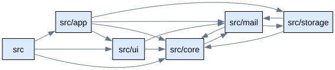
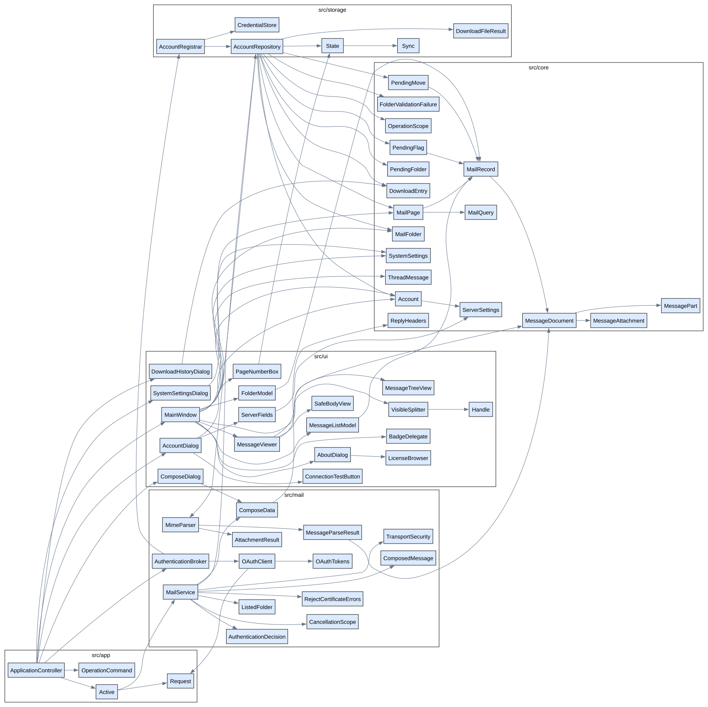

# 構成と依存関係

## モジュール

アプリはC++20／Qt Widgetsで構成します。`src/main.cpp`が起動入口です。

| ディレクトリ | 役割・主な依存 |
|---|---|
| `src/app` | `ApplicationController`がUI操作と非同期メール処理を接続。UI・保存・通信・認証を統括 |
| `src/core` | アカウント・メール・接続設定等の値モデル、診断、スレッド構築。Qt Core。他のソースディレクトリには依存しない |
| `src/storage` | SQLiteによるアカウント・メールキャッシュ、設定、添付保存。Qt SQL、QtKeychain、MIME・OAuth |
| `src/mail` | IMAP／SMTP、接続方針、認証仲介。KIMAP、KSMTP、保存層、MIME・OAuth |
| `src/mime` | MIME解析・生成。KMime、共通モデル・スレッド構築。通信・保存層には依存しない |
| `src/oauth` | OAuthクライアントと認可データの変換。Qt Network。他のソースディレクトリには依存しない |
| `src/ui` | メイン画面、本文・一覧・各ダイアログ。Qt Widgets、保存層、スレッド構築 |

CMakeでは診断・接続方針・OAuth・保存・認証・スレッド・通信・MIME・UIを`smoothmail_*`静的ライブラリに分け、実行対象`smoothmail`へリンクします。外部LGPLライブラリは動的リンクです。

ソースディレクトリの依存は、`app → ui → mail → storage → mime → core`の向き（途中の層を飛ばす参照を含む）と、各利用層から独立した`oauth`への参照に整理しています。保存層から通信層への参照は持ちません。`tests/python/test_directory_dependencies.py`で直接includeの解決・循環の不在・層の向きを検査します。

標準の`debug`／`release` presetは、MSVC付属NMakeを使う薄い外側の入口です。`cmake/RunBuildWorkflow.cmake`が依存と本体の構築を管理し、配置・通知・ソース収集・圧縮だけをPythonへ委譲します。Releaseの2行ビルドと`tools/build.py dist`は同じ経路を通り、生成後の法的監査・公開は配布担当者が行います。

通信・MIME解析・DB処理はGUIスレッドから分離し、DB接続は専用ワーカー内で管理します。

## 外部ライブラリ・ツール

| 分類 | 使用対象 |
|---|---|
| GUI・基盤 | Qt Core／Gui／Widgets／Network／Sql。推移依存にXml／Svg。QSQLITE、Windows TLS・platformプラグイン |
| メール | KIMAP、KSMTP、KMime、KCodecs、Cyrus SASLとPLAIN／LOGIN／XOAUTH2機構 |
| KDE基盤 | KIOCore、KI18n、KService、KConfigCore、KCoreAddons、KCrash |
| 秘密情報 | QtKeychain |
| GNUランタイム | libiconv、gettext-libintl |
| ビルド | Git、CMake、MSVC 2022 x64／Windows SDK、既存Qt SDK。ECM、Ninja、vcpkg、gettextホストツール、winflexbisonは依存構築で準備 |
| バッチ・依存内処理 | Python 3.11以降（本体のコンパイル処理には使用しない） |
| テスト | Qt Test、CTest、合成IMAP／SMTP／OAuthサーバ |
| 依存図・表 | Doxygen、Graphviz（`dot`・`tred`・`unflatten`）、Tree-sitterとC++文法。資料の再生成時のみ必要 |

固定版・取得元は[`dependencies.json`](../../cmake/dependencies.json)、[`native-dependencies.json`](../../cmake/native-dependencies.json)、[`source-archives.json`](../../cmake/source-archives.json)を参照してください。

## 自動生成した依存図

矢印は利用側から依存先を表します。ターゲット図では青が当プロジェクト、橙が外部ライブラリです。他の図は当プロジェクトだけを対象とします。

### CMakeターゲット


### ソースファイル


### ソースディレクトリ



### クラス



## ターゲット別ソース一覧（自動生成）

<!-- BEGIN GENERATED SOURCE TABLES -->

### `smoothmail`

| ソースファイル | 定義クラス | 定義グローバル関数 | includeヘッダ |
|---|---|---|---|
| src/app/applicationcontroller.cpp | OperationCommand |  | &quot;applicationcontroller.h&quot;<br>&quot;core/oauthconfiguration.h&quot;<br>&quot;mail/authenticationbroker.h&quot;<br>&quot;mail/mailservice.h&quot;<br>&quot;storage/accountregistrar.h&quot;<br>&quot;ui/accountdialog.h&quot;<br>&quot;ui/composedialog.h&quot;<br>&quot;ui/downloadhistorydialog.h&quot;<br>&quot;ui/mainwindow.h&quot;<br>&quot;ui/systemsettingsdialog.h&quot;<br>&lt;QApplication&gt;<br>&lt;QDesktopServices&gt;<br>&lt;QLineEdit&gt;<br>&lt;QMessageBox&gt;<br>&lt;QPlainTextEdit&gt;<br>&lt;QProgressDialog&gt;<br>&lt;QSettings&gt;<br>&lt;QStandardPaths&gt;<br>&lt;QStatusBar&gt;<br>&lt;QTextDocument&gt;<br>&lt;QUndoCommand&gt;<br>&lt;QUndoStack&gt;<br>&lt;QUuid&gt;<br>&lt;utility&gt; |
| src/app/applicationcontroller.h | ApplicationController<br>Active<br>Request |  | &quot;core/account.h&quot;<br>&quot;core/systemsettings.h&quot;<br>&lt;QHash&gt;<br>&lt;QObject&gt;<br>&lt;QPointer&gt;<br>&lt;QQueue&gt;<br>&lt;QSet&gt; |
| src/main.cpp |  | main | &quot;app/applicationcontroller.h&quot;<br>&quot;core/diagnostics.h&quot;<br>&quot;core/singleinstance.h&quot;<br>&quot;ui/mainwindow.h&quot;<br>&lt;QApplication&gt;<br>&lt;QMessageBox&gt;<br>&lt;QStandardPaths&gt; |

### `smoothmail_auth`

| ソースファイル | 定義クラス | 定義グローバル関数 | includeヘッダ |
|---|---|---|---|
| src/mail/authenticationbroker.cpp |  |  | &quot;authenticationbroker.h&quot;<br>&quot;core/oauthconfiguration.h&quot;<br>&quot;storage/accountregistrar.h&quot;<br>&quot;storage/credentialstore.h&quot;<br>&lt;QPointer&gt; |
| src/mail/authenticationbroker.h | AuthenticationBroker |  | &quot;core/account.h&quot;<br>&quot;core/systemsettings.h&quot;<br>&quot;oauth/oauthclient.h&quot;<br>&lt;QHash&gt;<br>&lt;QPointer&gt;<br>&lt;functional&gt;<br>&lt;optional&gt; |

### `smoothmail_connection_policy`

| ソースファイル | 定義クラス | 定義グローバル関数 | includeヘッダ |
|---|---|---|---|
| src/mail/connectionpolicy.cpp |  | authenticationDecision | &quot;connectionpolicy.h&quot; |
| src/mail/connectionpolicy.h | AuthenticationDecision<br>TransportSecurity |  | &quot;core/connectionsettings.h&quot;<br>&lt;QString&gt;<br>&lt;QStringList&gt; |

### `smoothmail_diagnostics`

| ソースファイル | 定義クラス | 定義グローバル関数 | includeヘッダ |
|---|---|---|---|
| src/core/diagnostics.cpp |  | aborted<br>appendRecord<br>containsFixed<br>crtReport<br>crtReportWide<br>currentOperation<br>event<br>fatal<br>finish<br>folderValidationFailure<br>nextOperation<br>qtMessage<br>qtStage<br>recordStack<br>start<br>terminated<br>writeFixed<br>writeNumber | &quot;diagnostics.h&quot;<br>&lt;QCoreApplication&gt;<br>&lt;QCryptographicHash&gt;<br>&lt;QDateTime&gt;<br>&lt;QDir&gt;<br>&lt;QFile&gt;<br>&lt;QLoggingCategory&gt;<br>&lt;QMutex&gt;<br>&lt;QScopedValueRollback&gt;<br>&lt;QUuid&gt;<br>&lt;atomic&gt;<br>&lt;crtdbg.h&gt;<br>&lt;csignal&gt;<br>&lt;cstdlib&gt;<br>&lt;exception&gt;<br>&lt;windows.h&gt; |
| src/core/diagnostics.h | FolderValidationFailure<br>OperationScope |  | &lt;QString&gt; |

### `smoothmail_mime`

| ソースファイル | 定義クラス | 定義グローバル関数 | includeヘッダ |
|---|---|---|---|
| src/mime/messagecomposer.cpp |  | addresses<br>composeMessage<br>replyDraft | &quot;messagecomposer.h&quot;<br>&quot;mimeparser.h&quot;<br>&lt;KMime/Headers&gt;<br>&lt;KMime/Message&gt;<br>&lt;QDateTime&gt; |
| src/mime/messagecomposer.h | ComposeData<br>ComposedMessage |  | &quot;core/messagedocument.h&quot;<br>&quot;core/threading.h&quot;<br>&lt;QMetaType&gt; |
| src/mime/mimeparser.cpp |  | collectParts | &quot;mimeparser.h&quot;<br>&lt;KMime/Content&gt;<br>&lt;KMime/Headers&gt;<br>&lt;KMime/Message&gt;<br>&lt;KMime/Util&gt;<br>&lt;utility&gt; |
| src/mime/mimeparser.h | AttachmentResult<br>MessageParseResult<br>MimeParser |  | &quot;core/messagedocument.h&quot; |

### `smoothmail_oauth`

| ソースファイル | 定義クラス | 定義グローバル関数 | includeヘッダ |
|---|---|---|---|
| src/oauth/oauthclient.cpp |  | form<br>pkceChallenge<br>randomUrlValue<br>refreshGrant<br>refreshTokenFromGrant<br>safeOpaque<br>scope | &quot;oauthclient.h&quot;<br>&lt;QCryptographicHash&gt;<br>&lt;QHostAddress&gt;<br>&lt;QJsonDocument&gt;<br>&lt;QJsonObject&gt;<br>&lt;QNetworkAccessManager&gt;<br>&lt;QNetworkReply&gt;<br>&lt;QNetworkRequest&gt;<br>&lt;QRandomGenerator&gt;<br>&lt;QRegularExpression&gt;<br>&lt;QTcpSocket&gt;<br>&lt;QUrlQuery&gt;<br>&lt;memory&gt; |
| src/oauth/oauthclient.h | OAuthClient<br>OAuthTokens |  | &lt;QDateTime&gt;<br>&lt;QObject&gt;<br>&lt;QPointer&gt;<br>&lt;QTcpServer&gt;<br>&lt;QTimer&gt;<br>&lt;QUrl&gt; |

### `smoothmail_storage`

| ソースファイル | 定義クラス | 定義グローバル関数 | includeヘッダ |
|---|---|---|---|
| src/core/account.cpp |  | accountFromJson<br>accountJson<br>noControls<br>readServer<br>serverJson<br>validateAccount | &quot;account.h&quot;<br>&lt;QRegularExpression&gt;<br>&lt;QUuid&gt; |
| src/core/account.h | Account<br>ServerSettings |  | &quot;connectionsettings.h&quot;<br>&lt;QJsonObject&gt;<br>&lt;QMetaType&gt;<br>&lt;QString&gt; |
| src/core/connectionsettings.h |  |  |  |
| src/storage/accountregistrar.cpp |  |  | &quot;accountregistrar.h&quot;<br>&quot;oauth/oauthclient.h&quot;<br>&lt;QPointer&gt;<br>&lt;QUuid&gt; |
| src/storage/accountregistrar.h | AccountRegistrar |  | &quot;accountrepository.h&quot;<br>&quot;credentialstore.h&quot;<br>&lt;QHash&gt; |
| src/storage/accountrepository.cpp | State<br>Sync | handleIdentity<br>identifiers<br>indexMessage<br>journal<br>overlayFolders<br>recordSqlError<br>serverFolder<br>sql<br>summaryRecord<br>underFolder<br>validFolderMetadata | &quot;accountrepository.h&quot;<br>&quot;core/diagnostics.h&quot;<br>&quot;downloadfile.h&quot;<br>&quot;mime/mimeparser.h&quot;<br>&lt;QDir&gt;<br>&lt;QFileInfo&gt;<br>&lt;QHash&gt;<br>&lt;QJsonArray&gt;<br>&lt;QJsonDocument&gt;<br>&lt;QJsonObject&gt;<br>&lt;QSet&gt;<br>&lt;QSqlDatabase&gt;<br>&lt;QSqlError&gt;<br>&lt;QSqlQuery&gt;<br>&lt;QTimeZone&gt;<br>&lt;QTimer&gt;<br>&lt;QUuid&gt;<br>&lt;limits&gt; |
| src/storage/accountrepository.h | AccountRepository |  | &quot;core/account.h&quot;<br>&quot;core/downloadentry.h&quot;<br>&quot;core/mailpage.h&quot;<br>&quot;core/mailrecord.h&quot;<br>&quot;core/pendingflag.h&quot;<br>&quot;core/pendingfolder.h&quot;<br>&quot;core/pendingmove.h&quot;<br>&lt;QObject&gt;<br>&lt;QThread&gt;<br>&lt;atomic&gt; |
| src/storage/credentialstore.cpp |  | jobError | &quot;credentialstore.h&quot;<br>&lt;QPointer&gt;<br>&lt;qt6keychain/keychain.h&gt; |
| src/storage/credentialstore.h | CredentialStore |  | &lt;QObject&gt;<br>&lt;QQueue&gt;<br>&lt;functional&gt; |
| src/storage/downloadfile.cpp |  | safeDownloadName<br>saveDownloadFile | &quot;downloadfile.h&quot;<br>&lt;QDir&gt;<br>&lt;QFile&gt;<br>&lt;QFileInfo&gt;<br>&lt;QRegularExpression&gt; |
| src/storage/downloadfile.h | DownloadFileResult |  | &lt;QByteArray&gt;<br>&lt;QString&gt; |

### `smoothmail_threading`

| ソースファイル | 定義クラス | 定義グローバル関数 | includeヘッダ |
|---|---|---|---|
| src/core/threading.cpp |  | compactThreadParents<br>newMessageId<br>replyHeaders<br>threadParents<br>validMessageId | &quot;threading.h&quot;<br>&lt;QHash&gt;<br>&lt;QRegularExpression&gt;<br>&lt;QSet&gt;<br>&lt;QUuid&gt;<br>&lt;algorithm&gt;<br>&lt;numeric&gt; |
| src/core/threading.h | ReplyHeaders<br>ThreadMessage |  | &lt;QByteArray&gt;<br>&lt;QList&gt;<br>&lt;QString&gt; |

### `smoothmail_transport`

| ソースファイル | 定義クラス | 定義グローバル関数 | includeヘッダ |
|---|---|---|---|
| src/mail/mailservice.cpp | CancellationScope<br>ListedFolder<br>RejectCertificateErrors | hasFolderFlag<br>initializeSasl<br>interrupted<br>mergeFolderFlags<br>runJob<br>testImap<br>testSmtp | &quot;connectionpolicy.h&quot;<br>&quot;core/diagnostics.h&quot;<br>&quot;mailservice.h&quot;<br>&quot;mime/mimeparser.h&quot;<br>&quot;storage/accountrepository.h&quot;<br>&lt;KIMAP/AppendJob&gt;<br>&lt;KIMAP/CapabilitiesJob&gt;<br>&lt;KIMAP/CreateJob&gt;<br>&lt;KIMAP/DeleteJob&gt;<br>&lt;KIMAP/FetchJob&gt;<br>&lt;KIMAP/ListJob&gt;<br>&lt;KIMAP/LoginJob&gt;<br>&lt;KIMAP/MoveJob&gt;<br>&lt;KIMAP/RenameJob&gt;<br>&lt;KIMAP/SearchJob&gt;<br>&lt;KIMAP/SelectJob&gt;<br>&lt;KIMAP/Session&gt;<br>&lt;KIMAP/StatusJob&gt;<br>&lt;KIMAP/StoreJob&gt;<br>&lt;KLocalizedString&gt;<br>&lt;KMime/Headers&gt;<br>&lt;KSMTP/LoginJob&gt;<br>&lt;KSMTP/SendJob&gt;<br>&lt;KSMTP/Session&gt;<br>&lt;QDataStream&gt;<br>&lt;QDir&gt;<br>&lt;QElapsedTimer&gt;<br>&lt;QEventLoop&gt;<br>&lt;QHash&gt;<br>&lt;QMutex&gt;<br>&lt;QSet&gt;<br>&lt;QSslSocket&gt;<br>&lt;QTemporaryFile&gt;<br>&lt;QTimer&gt;<br>&lt;functional&gt;<br>&lt;sasl/sasl.h&gt; |
| src/mail/mailservice.h | MailService |  | &quot;core/account.h&quot;<br>&quot;core/mailrecord.h&quot;<br>&quot;mime/messagecomposer.h&quot;<br>&lt;QObject&gt;<br>&lt;QThread&gt;<br>&lt;atomic&gt; |

### `smoothmail_ui`

| ソースファイル | 定義クラス | 定義グローバル関数 | includeヘッダ |
|---|---|---|---|
| src/core/messagedocument.h | MessageAttachment<br>MessageDocument<br>MessagePart |  | &lt;QByteArray&gt;<br>&lt;QDateTime&gt;<br>&lt;QList&gt;<br>&lt;QString&gt;<br>&lt;QStringList&gt; |
| src/ui/aboutdialog.cpp | LicenseBrowser | initializeLicenseResources | &quot;aboutdialog.h&quot;<br>&lt;QDesktopServices&gt;<br>&lt;QDialogButtonBox&gt;<br>&lt;QFile&gt;<br>&lt;QJsonArray&gt;<br>&lt;QJsonDocument&gt;<br>&lt;QJsonObject&gt;<br>&lt;QLabel&gt;<br>&lt;QListWidget&gt;<br>&lt;QSplitter&gt;<br>&lt;QTextBrowser&gt;<br>&lt;QTextDocument&gt;<br>&lt;QUrl&gt;<br>&lt;QVBoxLayout&gt; |
| src/ui/aboutdialog.h | AboutDialog |  | &lt;QDialog&gt; |
| src/ui/accountdialog.cpp | ConnectionTestButton |  | &quot;accountdialog.h&quot;<br>&lt;QComboBox&gt;<br>&lt;QDialogButtonBox&gt;<br>&lt;QFormLayout&gt;<br>&lt;QGroupBox&gt;<br>&lt;QLabel&gt;<br>&lt;QLineEdit&gt;<br>&lt;QPushButton&gt;<br>&lt;QSpinBox&gt;<br>&lt;QStyleOptionButton&gt;<br>&lt;QStylePainter&gt;<br>&lt;QUuid&gt;<br>&lt;QVBoxLayout&gt; |
| src/ui/accountdialog.h | AccountDialog<br>ServerFields |  | &quot;core/account.h&quot;<br>&lt;QDialog&gt; |
| src/ui/composedialog.cpp |  |  | &quot;composedialog.h&quot;<br>&lt;QFormLayout&gt;<br>&lt;QHBoxLayout&gt;<br>&lt;QKeyEvent&gt;<br>&lt;QLabel&gt;<br>&lt;QLineEdit&gt;<br>&lt;QMouseEvent&gt;<br>&lt;QPlainTextEdit&gt;<br>&lt;QPushButton&gt;<br>&lt;QScreen&gt;<br>&lt;QVBoxLayout&gt; |
| src/ui/composedialog.h | ComposeDialog |  | &quot;mime/messagecomposer.h&quot;<br>&lt;QDialog&gt; |
| src/ui/downloadhistorydialog.cpp |  |  | &quot;core/displaytime.h&quot;<br>&quot;downloadhistorydialog.h&quot;<br>&lt;QDesktopServices&gt;<br>&lt;QFileInfo&gt;<br>&lt;QMenu&gt;<br>&lt;QScreen&gt;<br>&lt;QStandardItemModel&gt;<br>&lt;QTreeView&gt;<br>&lt;QUrl&gt;<br>&lt;QVBoxLayout&gt; |
| src/ui/downloadhistorydialog.h | DownloadHistoryDialog |  | &quot;core/downloadentry.h&quot;<br>&lt;QDialog&gt; |
| src/ui/foldermodel.cpp |  | token | &quot;foldermodel.h&quot;<br>&lt;QJsonArray&gt;<br>&lt;QJsonDocument&gt;<br>&lt;QJsonObject&gt;<br>&lt;QMimeData&gt;<br>&lt;QSet&gt;<br>&lt;QUuid&gt; |
| src/ui/foldermodel.h | FolderModel<br>MessageListModel |  | &quot;core/mailrecord.h&quot;<br>&lt;QStandardItemModel&gt; |
| src/ui/mainwindow.cpp | BadgeDelegate<br>MessageTreeView<br>PageNumberBox | applicationIcon<br>badgeRect<br>pendingAction | &quot;aboutdialog.h&quot;<br>&quot;core/diagnostics.h&quot;<br>&quot;core/displaytime.h&quot;<br>&quot;core/threading.h&quot;<br>&quot;foldermodel.h&quot;<br>&quot;mainwindow.h&quot;<br>&quot;messageviewer.h&quot;<br>&quot;visiblesplitter.h&quot;<br>&lt;QAction&gt;<br>&lt;QApplication&gt;<br>&lt;QCheckBox&gt;<br>&lt;QCloseEvent&gt;<br>&lt;QDesktopServices&gt;<br>&lt;QHBoxLayout&gt;<br>&lt;QHeaderView&gt;<br>&lt;QItemSelectionModel&gt;<br>&lt;QKeyEvent&gt;<br>&lt;QLabel&gt;<br>&lt;QLineEdit&gt;<br>&lt;QMenuBar&gt;<br>&lt;QMessageBox&gt;<br>&lt;QMouseEvent&gt;<br>&lt;QPainter&gt;<br>&lt;QPainterPath&gt;<br>&lt;QPersistentModelIndex&gt;<br>&lt;QProgressBar&gt;<br>&lt;QPushButton&gt;<br>&lt;QScreen&gt;<br>&lt;QScrollBar&gt;<br>&lt;QSignalBlocker&gt;<br>&lt;QSpinBox&gt;<br>&lt;QSplitter&gt;<br>&lt;QStandardItemModel&gt;<br>&lt;QStatusBar&gt;<br>&lt;QStyle&gt;<br>&lt;QStyledItemDelegate&gt;<br>&lt;QSystemTrayIcon&gt;<br>&lt;QTimer&gt;<br>&lt;QTreeView&gt;<br>&lt;QUuid&gt;<br>&lt;QVBoxLayout&gt;<br>&lt;algorithm&gt;<br>&lt;cmath&gt;<br>&lt;functional&gt; |
| src/ui/mainwindow.h | MainWindow |  | &quot;core/account.h&quot;<br>&quot;core/mailpage.h&quot;<br>&quot;core/mailrecord.h&quot;<br>&quot;core/systemsettings.h&quot;<br>&lt;QHash&gt;<br>&lt;QMainWindow&gt;<br>&lt;QSet&gt;<br>&lt;optional&gt; |
| src/ui/messageviewer.cpp |  | summaryHtml<br>valueHtml | &quot;core/displaytime.h&quot;<br>&quot;messageviewer.h&quot;<br>&quot;safebodyview.h&quot;<br>&quot;visiblesplitter.h&quot;<br>&lt;QFrame&gt;<br>&lt;QHBoxLayout&gt;<br>&lt;QKeyEvent&gt;<br>&lt;QLabel&gt;<br>&lt;QLineEdit&gt;<br>&lt;QListWidget&gt;<br>&lt;QPlainTextEdit&gt;<br>&lt;QScrollBar&gt;<br>&lt;QShortcut&gt;<br>&lt;QSplitter&gt;<br>&lt;QStyle&gt;<br>&lt;QTextCursor&gt;<br>&lt;QTimer&gt;<br>&lt;QToolButton&gt;<br>&lt;QVBoxLayout&gt;<br>&lt;algorithm&gt; |
| src/ui/messageviewer.h | MessageViewer |  | &quot;core/messagedocument.h&quot;<br>&lt;QUrl&gt;<br>&lt;QWidget&gt; |
| src/ui/safebodyview.cpp |  | trimUrlPunctuation | &quot;safebodyview.h&quot;<br>&lt;QRegularExpression&gt;<br>&lt;QTextCharFormat&gt;<br>&lt;QTextCursor&gt;<br>&lt;QUrl&gt; |
| src/ui/safebodyview.h | SafeBodyView |  | &lt;QTextBrowser&gt; |
| src/ui/systemsettingsdialog.cpp |  |  | &quot;systemsettingsdialog.h&quot;<br>&lt;QCheckBox&gt;<br>&lt;QDialogButtonBox&gt;<br>&lt;QFormLayout&gt;<br>&lt;QGroupBox&gt;<br>&lt;QLabel&gt;<br>&lt;QLineEdit&gt;<br>&lt;QMessageBox&gt;<br>&lt;QPushButton&gt;<br>&lt;QSpinBox&gt; |
| src/ui/systemsettingsdialog.h | SystemSettingsDialog |  | &quot;core/systemsettings.h&quot;<br>&lt;QDialog&gt; |
| src/ui/visiblesplitter.h | VisibleSplitter<br>Handle |  | &lt;QPainter&gt;<br>&lt;QSplitter&gt;<br>&lt;QSplitterHandle&gt; |

<!-- END GENERATED SOURCE TABLES -->

## 依存図および表の再生成方法

```text
python tools/setup_architecture.py
python tools/generate_architecture.py
```

## 依存図および表の生成手法

- PythonとCMake以外は、固定版のuv経由で専用Python・Tree-sitter・Graphviz・Ninjaを、公式配布からDoxygenを自動取得します。専用環境は`.cache/architecture/`に置き、本体ビルドや既存SDKを変更しません。
- 本体と共通のCMakeターゲット宣言を、コンパイラ・Qt SDK不要の文書用モデルとして評価し、Graphviz依存図とターゲット別ソース一覧を取得します。外部は直接のリンク先を表し、SDK内部の推移依存は含めません。
- Doxygenのinclude／参照情報とTree-sitterの構文木からファイル・ディレクトリ・クラス依存を抽出します。テスト・外部ソースを除き、ファイル図は同名`.h`／`.cpp`を統合します。ファイル図・クラス図は定義元ディレクトリでグループ化し、`tred`と`unflatten -l 3 -f`を適用します。
- クラス依存は戻り値・引数・内部変数・呼出しを対象とし、グローバル関数の連鎖をクラス間の辺へ還元します。名前空間は内部で区別し、表示では省略します。実行時の動的呼出しやテンプレートの全実体化を保証する解析ではありません。
- 表は1ソース1行とし、各一覧を`<br>`で改行します。生成マーカー内の表と4種類のDOT／SVGだけを再生成し、手書き部分を保持します。
